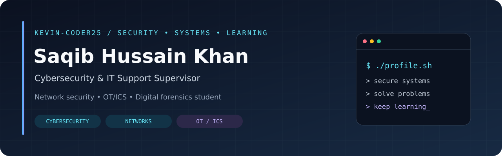

**Cybersecurity & IT Support Supervisor | Network Security | OT/ICS Security**

BS Digital Forensics and Cybersecurity student • Industrial electronics background • Karachi, Pakistan

---

### 👋 A little about me

I'm **Saqib Hussain Khan**, a Cybersecurity and IT Support Supervisor with a background in field engineering and industrial electronics. My work brings together network administration, domain management, end-user support, and the reliability of industrial systems.

I'm pursuing a **BS in Digital Forensics and Cybersecurity at Hamdard University**, with a focus on developing my capabilities in **OT/ICS security, SOC operations, and digital investigations**.

- 🛡️ **Cybersecurity & IT support** — cybersecurity policy implementation, CERT participation, compliance auditing, and technical documentation.
- 🌐 **Networking** — network design, Cisco IOS, pfSense, and industrial network connectivity.
- 🔧 **Field engineering** — diagnostics and maintenance of tank level indication and fire alarm systems.
- 🐧 **Hands-on learning** — Linux administration, Bash automation, and practical software projects.

### 💼 Professional background

**IT Support and Cybersecurity Supervisor**  
Pakistan Navy – Ship Building Dockyard · **March 2019–present**

Network administration, domain management, device support, and software/hardware troubleshooting. As a CERT team member, I contribute to cybersecurity policy implementation, compliance auditing, and documentation that supports secure operations and continuity.

My field engineering experience also includes installation and maintenance of industrial instrumentation and safety systems, alongside industrial network diagnostics and troubleshooting.

### 🎓 Education

| Qualification | Institution | Dates |
| :--- | :--- | :--- |
| BS, Digital Forensics and Cybersecurity | Hamdard University | September 2025–September 2029 (in progress) |
| Diploma of Associate Engineering, Industrial Electronics | Pakistan Navy Polytechnic Institute Karachi | January 2016–December 2018 |

### 🛡️ Security & networking focus

  
  
  
  

### 🛠️ Technologies in my projects

  
  
  
  
  
   
  
  
  
  
  

### 🚀 Featured projects

<table>
<tr>
<td width="50%" valign="top">
<h3>🐧 Linux Administration Lab</h3>

Hands-on Linux administration, troubleshooting notes, and automated system health reports.

<strong>Linux · Bash · systemd</strong>

<a href="https://github.com/kevin-coder25/linux-admin-lab">Explore the lab →</a>

</td>
<td width="50%" valign="top">
<h3>⚡ GridGuard AI</h3>

A local smart-grid monitoring demo with simulated edge devices, MQTT telemetry, and a live dashboard.

<strong>C++ · Python · MQTT · SQLite</strong>

<a href="https://github.com/kevin-coder25/hackathon-project-2026">Explore the system →</a>

</td>
</tr>
<tr>
<td width="50%" valign="top">
<h3>📅 ProductiveFlow</h3>

A daily task tracker with a 31-day consistency matrix, user accounts, and progress visualizations.

<strong>PHP · MySQL · JavaScript</strong>

<a href="https://github.com/kevin-coder25/dailytask-tracker">Explore the app →</a>

</td>
<td width="50%" valign="top">
<h3>🏦 Banking System</h3>

A console banking simulation with account types, transfers, transaction history, and customer/admin menus.

<strong>C# · .NET · Object-oriented programming</strong>

<a href="https://github.com/kevin-coder25/bankmanagementsystem">Explore the project →</a>

</td>
</tr>
</table>

### 📚 Certifications & learning

- Foundations of Cybersecurity
- Introduction to Kali Linux Basics
- C++ Essentials 1
- Introduction to Modern AI
- Certificate of Participation — AIHackathon, Karachi Regional Technical Evaluation

**Developing toward:** protecting critical infrastructure, SOC operations, and digital forensics, supported by Linux labs and programming practice.

<strong>📂 More from my learning journey</strong>

 

- [C++ projects](https://github.com/kevin-coder25/projects-C-)
- [Object-oriented programming](https://github.com/kevin-coder25/oop_C-)
- [Python practice](https://github.com/kevin-coder25/python)

---

  Build something useful. Understand how it works. Document what you learn.

